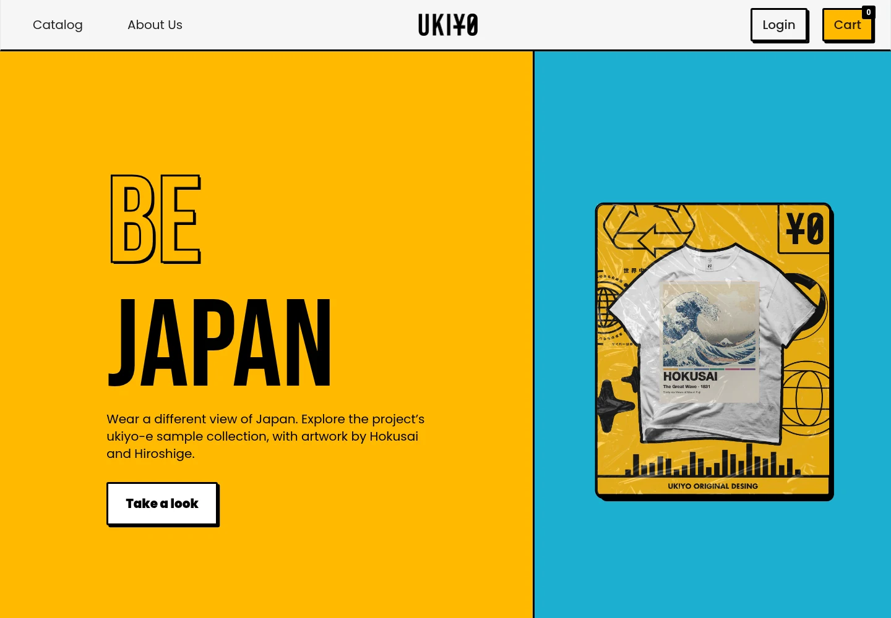

# Ukiyo Store — commerce case study

A visual case study of an apparel storefront built in two stages: a WordPress/WooCommerce shop and a custom Angular frontend for the same catalogue.

The study follows the shopping journey — discovery, search and filters, product variants, cart and responsive behaviour — using the project's six ukiyo-e sample shirts. Products, prices and variants are demo data.



## View the case study

The full presentation is in [`docs/index.html`](docs/index.html): platform comparison, interactive journey, desktop and mobile captures, design decisions and the evidence behind them.

```sh
npm install
npm run preview
```

Open **http://127.0.0.1:18782**. The presentation is static; it does not need a frontend build or external APIs.

## What it covers

### WordPress + WooCommerce

Brand-led merchandising with Astra and Elementor, product configuration and a guest cart handled by WooCommerce. The catalogue uses the same six sample shirts as the Angular application.

### Angular + Firebase / Express

A custom storefront with live search, category and theme filters, product variants, a Firebase-backed cart, authentication and admin routes, and an Express checkout service. The local edition runs against Firebase emulators with the sample catalogue.

### Responsive behaviour

Desktop and 390 × 844 mobile captures of the Angular catalogue, filters, product page and purchase action. The original mobile overflow is preserved; it is not a claim of WCAG conformance.

### Shopify

The presentation records Shopify as outside the scope of this case study. No implementation, theme export or interface capture is included, so no substitute UI or dates are shown.

## Stack

| Layer | Technology |
| --- | --- |
| WordPress storefront | WordPress 6.6.2, WooCommerce 8.0.1, Astra 4.0.1, Elementor 3.15.3, PHP 8.2, MariaDB 11 |
| Angular frontend | Angular 14.2, TypeScript 4.7, RxJS 7.5, Angular Material/CDK 13, Tailwind 3.4 |
| Application services | Firebase 9.9, AngularFire 7.4, Express 4.18, Stripe 10.17, Nodemailer 6.9 |
| Presentation | Static HTML, CSS and JavaScript; Playwright for captures |

## Repository layout

- `docs/index.html` — the written and visual case study.
- `docs/case-study.css`, `docs/case-study.js` — presentation layout and interactions.
- `docs/images/runtime/` — browser captures and WebP derivatives.
- `docs/video/` — the Angular search-to-cart walkthrough.
- `docs/capture-manifest.json` — capture metadata, viewports and interaction checks.
- `docs/technical-notes.md` — local setup, architecture and capture details.
- `docs/samples.md` — sample catalogue and version information.
- `scripts/` — capture, recording and presentation checks.
- `package.json` — preview, capture, record and test commands.

## Run the presentation tests

```sh
npm test
```

The check covers image loading, chapter anchors, five viewport widths, horizontal overflow, journey tabs, keyboard navigation, the image dialog and the JavaScript-disabled fallback. It tests the presentation, not the legacy shops.

## Capture the applications

The capture scripts expect local WordPress and Angular instances on loopback, Firebase emulators and the six-sample catalogue. See [`docs/technical-notes.md`](docs/technical-notes.md) for the full setup.

```sh
npx playwright install chromium
npm run capture
python scripts/optimize-captures.py
npm run record
```

Do not point the capture scripts at a production shop: they add a guest-cart item.

## Data and scope

- The six shirt designs and their artwork were already part of the project. The catalogue, EUR prices and variants are demonstration data.
- The repository contains documentation, presentation assets and capture scripts. It does not contain the WordPress backup, database, credentials, original Angular source or Firebase export.
- No revenue, conversion, traffic, customer count, production deployment, payment or email delivery is claimed.
- WordPress, WooCommerce, Astra, Elementor, Angular, Firebase and Shopify are third-party products. Their development is not attributed to the author.
- Product artwork and platform marks remain their respective owners' property. No licence for reuse of the legacy application or this repository is granted.

## Documentation

- [Full case study](docs/index.html)
- [Architecture and local setup](docs/technical-notes.md)
- [Sample catalogue](docs/samples.md)
- [Capture manifest](docs/capture-manifest.json)
