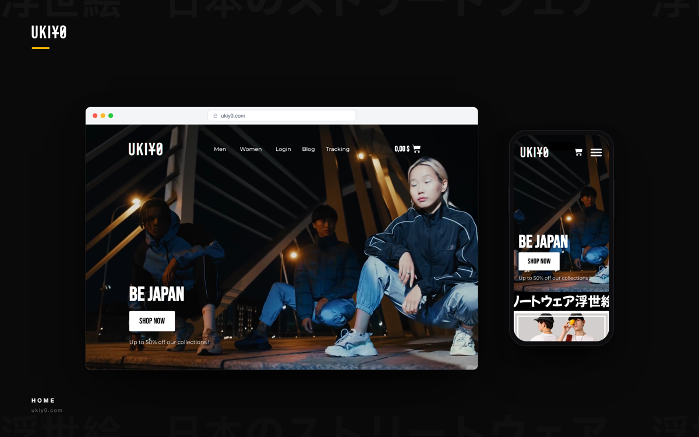
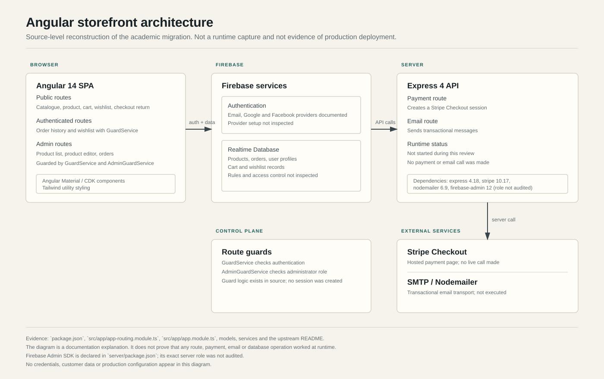
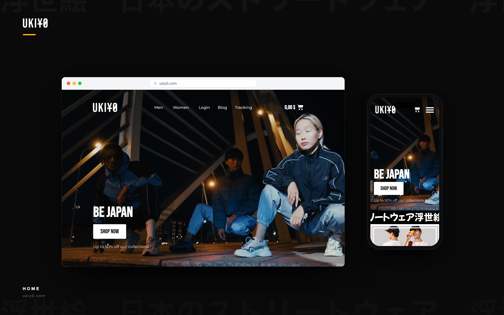
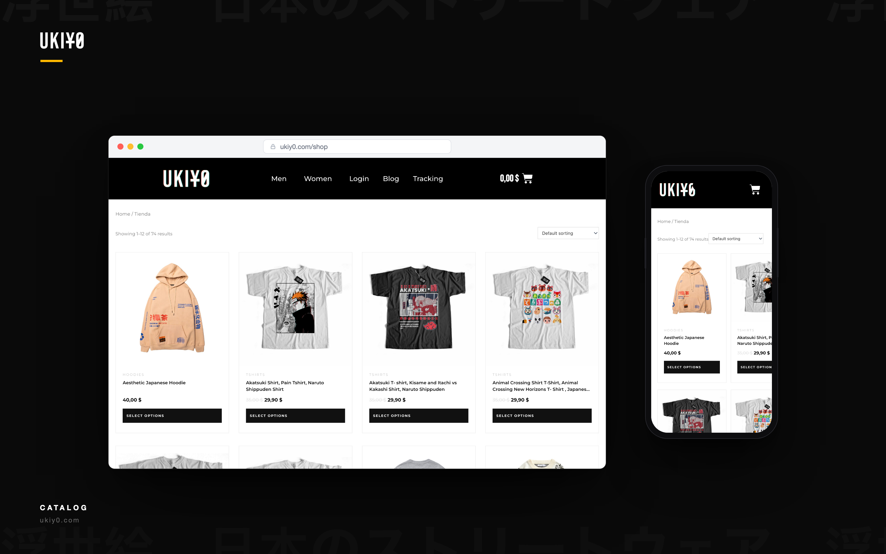
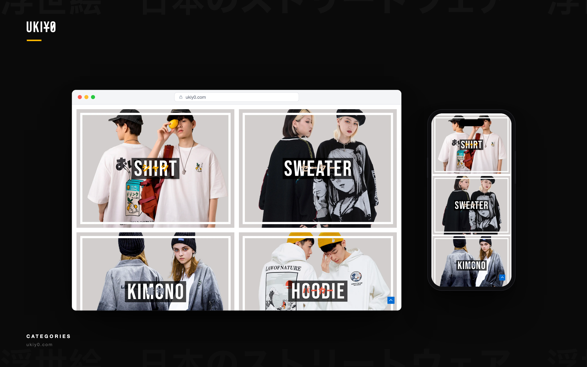
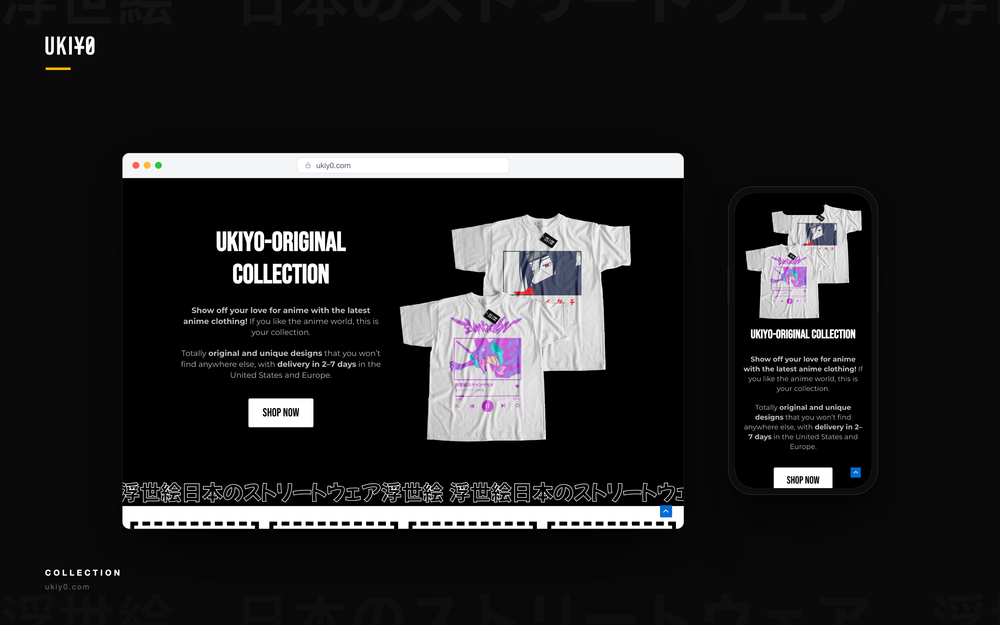
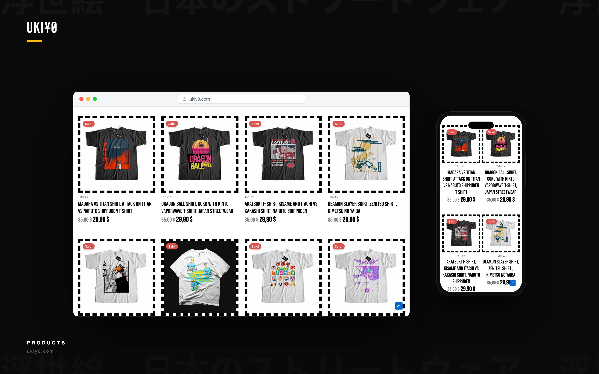
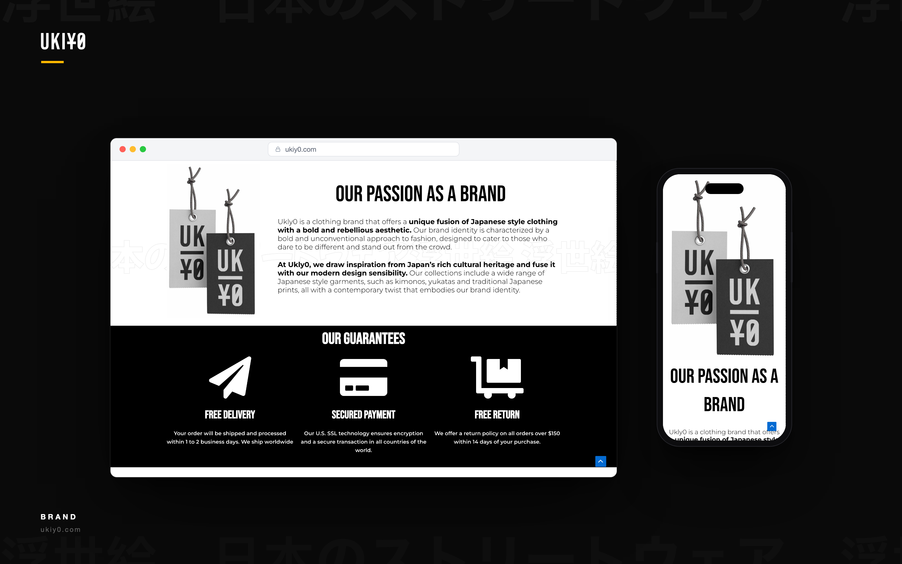
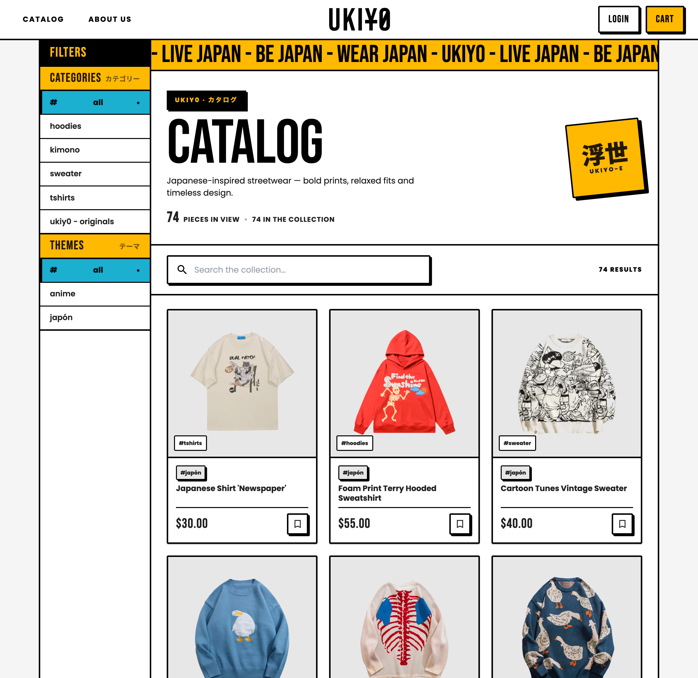
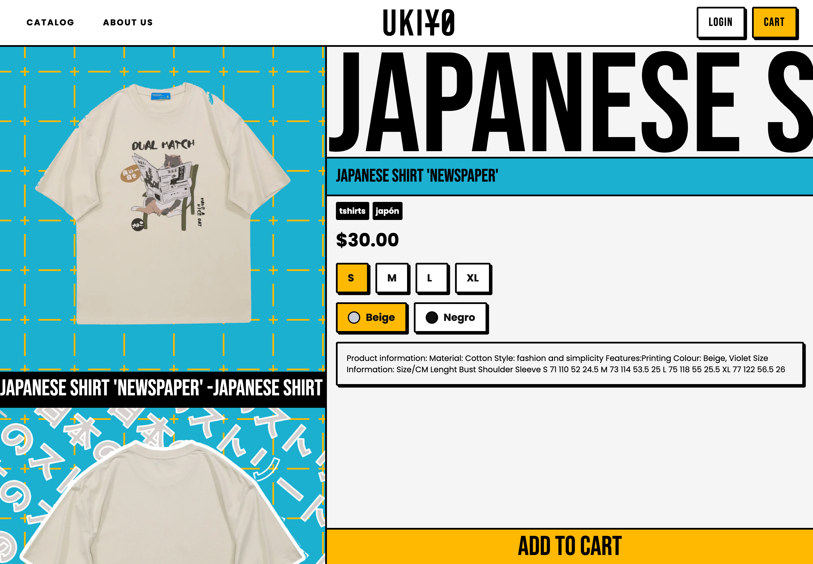

# Ukiyo Store commerce case study

A documentation-only study of an apparel storefront across two stages: a WordPress/WooCommerce storefront archived from 2022-2024 and an Angular final-degree migration from 2023-2024. It describes the structure visible in the sources and separates source-level implementation from runtime validation.

The story also includes a September 2026 local recovery: restoring the original WordPress design from a full-site backup, refining the catalogue presentation and producing responsive portfolio compositions from the restored interface. [Recovery and design improvements](docs/recovery-and-improvements.md).

*Updated project cover, based on the recovered WordPress homepage in illustrative desktop/mobile frames.*

## At a glance

| | Historical stage | Angular stage |
|---|---|---|
| Period | 2022-2024 | 2023-2024 |
| Nature | Configured WordPress/WooCommerce storefront archive | Final-degree software migration |
| Runtime | Local restore recorded in September 2026; no current public deployment verified | Local catalogue and product pages captured in October 2026; backend flows not validated |
| Core | WordPress, WooCommerce, Astra, Elementor | Angular, Firebase, Express, Stripe |
| Visuals | Recovered interface in responsive desktop/mobile compositions | Fresh captures of the locally adapted Angular frontend |

## Historical storefront archive

The archive contains a configured WordPress 6.6.2 and WooCommerce 9.2.3 storefront with the Astra 4.0.1 theme, Elementor, payment and marketing plugins, and product media dated 2022-2024.

- The plugin set includes WooCommerce Payments, PayPal Payments, Google Listings and Ads, Pinterest, Facebook for WooCommerce, MailPoet and Woo Product Feed Pro.
- The media library and archive metadata show catalogue media and a full-site archive dated August 2023.
- The archive is a historical storefront record. It is not evidence of sales, revenue, customer counts or current operation.
- The theme, platform and plugins are third-party components; this case study does not attribute their development to the author.

## Angular migration

*Source-level architecture. It explains the observed structure; it is not a runtime capture.*

The Angular application is a single-page storefront with Firebase Authentication and Realtime Database, an Express API for checkout and email, Stripe Checkout, and route guards for customer and administrator areas.

The historical migration is visible in routes, models, services and package files. The local frontend has since been adapted to read a local catalogue and product images rather than depend on the unavailable Firebase catalogue. The screenshots below show that adapted frontend, not an end-to-end production migration.

## Visuals

### Original design, recovered locally

*Original storefront interface captured from the local restoration, presented in illustrative desktop and mobile frames. This is not the current public website, a new deployment or a public-domain image. The fashion photography belongs to the historical storefront media; no reuse rights are granted.*

The recovery brought back the Astra/Elementor homepage, including the “BE JAPAN” hero, navigation and original black-and-white identity. The local catalogue was subsequently refined with consistent image proportions, shorter titles, simpler actions and more regular spacing. These are presentation changes, not a claim of improved sales or performance. See the [recovery record and evidence limits](docs/recovery-and-improvements.md).

### WordPress catalogue — refined presentation

*Latest retained catalogue composition from the local restoration. Original product imagery; illustrative device frames. The mobile capture also exposes the existing horizontal clipping; this is not a responsive-quality certification.*

### WordPress sections

| Categories | Collection |
|---|---|
|  |  |

| Products | Brand |
|---|---|
|  |  |

*Original locally restored interface in illustrative frames, replacing the older standalone recreations. Historical photography and product artwork are not licensed for reuse.*

### Angular catalogue

*Fresh browser capture of the locally adapted Angular catalogue, taken on 25 October 2026. The frontend reads local catalogue data and product media; it is not connected to a working production backend.*

### Angular product detail

*Fresh browser capture of a local product page, taken on 25 October 2026. Displaying product data does not validate cart persistence, authentication or checkout.*

## Source-level features

| Capability | Source evidence | Runtime status |
|---|---|---|
| Catalogue and product detail | `home` and `product/:key` routes; product service and model | Local-data catalogue and one product page rendered for fresh captures; backend not validated |
| Filters and category browsing | Home components and category service | Implemented in source; not tested |
| Cart | `cart` route; cart service and model | Implemented in source; not tested |
| Wishlist | `wishlist` route; wishlist service; auth guard | Implemented in source; not tested |
| Authentication | Login component, auth service, AngularFireAuth | Implemented in source; not executed |
| Admin product management | Admin routes with auth and admin guards; product service | Implemented in source; not tested |
| Order history and admin orders | `orders` and `adminorders` routes; order service | Implemented in source; not tested |
| Checkout return and email | Success route with session id; Express and Nodemailer packages | Implemented in source; not executed |

The table records the original Angular source review, not a fully validated product. The later local screenshot pass verifies catalogue/product rendering only; payments, authentication, order persistence and email remain unvalidated.

## Stack

| Layer | Versions observed | Note |
|---|---|---|
| Angular frontend | Angular 14.2, TypeScript 4.7, RxJS 7.5, Material/CDK 13, Tailwind 3.4 | Legacy toolchain |
| Application services | Firebase 9.9, AngularFire 7.4, Express 4.18, Stripe 10.17, Nodemailer 6.9 | Server and client split |
| Historical storefront | WordPress 6.6.2, WooCommerce 9.2.3, Astra 4.0.1, Elementor | Archive snapshot, not current |

## Dates and origin

- 2022-09: first storefront media in the archive.
- 2023-08: full-site archive created.
- 2023-09: first Angular commit.
- 2024-06: final-degree delivery.
- 2025-09: documentation update in the source repository.
- 2026-09-18: local WordPress restoration, catalogue presentation changes and responsive compositions recorded in the recovery session.
- 2026-10-25: gallery refreshed with the retained WordPress responsive compositions and fresh local Angular catalogue/product captures; synthetic interface images replaced.

Dates describe evidence, not employment periods.

## Visual provenance

The current gallery replaces the older synthetic portfolio recreations. WordPress compositions come from the retained September 2026 recovery assets; Angular images are fresh captures of the locally modified frontend. Desktop/mobile frames and the cover layout are presentation devices, not application features.

Historical fashion photography, product prints and third-party characters visible in the interfaces remain the property of their respective rights holders. They are shown as contextual project evidence, not as original artwork by the author or reusable asset downloads. No licence for their reuse is granted. The WordPress and Angular names, themes, plugins and frameworks are also third-party work.

## Limitations and attribution

- The Angular project is academic and was not verified in production.
- The historical stage is a WordPress/WooCommerce archive, not a custom CMS or checkout implementation.
- No sales, revenue, conversion, customer or traffic claim is made.
- WordPress compositions show the locally restored interface; Angular captures show a local-data adaptation, not the unchanged upstream application.
- Product artwork visible in the gallery is third-party material; publication of screenshots grants no reuse rights.
- The historical WordPress restore has not been rerun for this update. Angular catalogue and product rendering were checked locally, not production deployment, checkout or payment flows.
- This repository contains documentation and portfolio visuals, not the legacy application's source code. No licence for reuse is granted.

Technical details are in `docs/technical-notes.md`.
