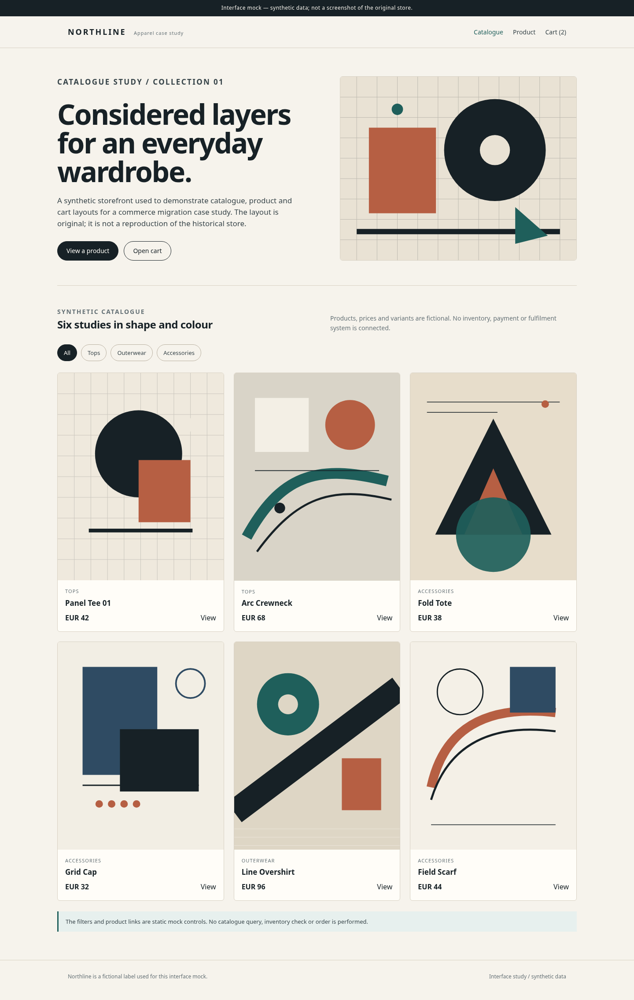
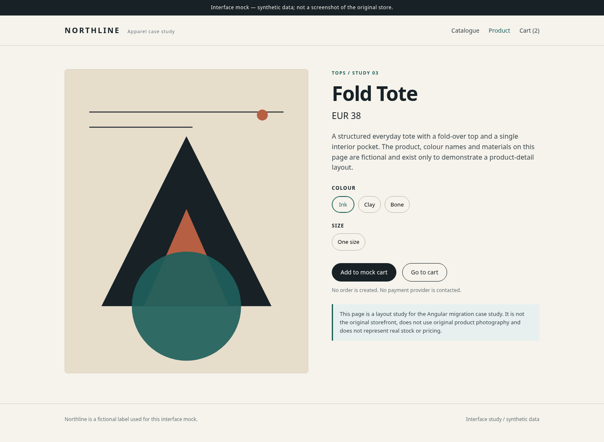
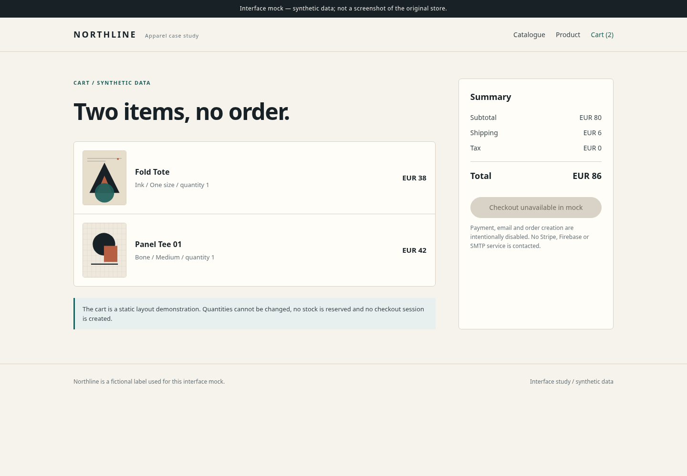
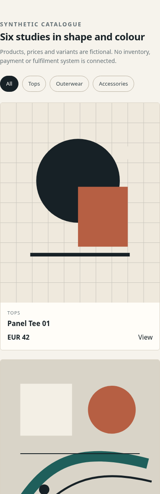

# Ukiyo Store commerce case study

A documentation-only study of two stages of an apparel storefront: a historical WordPress/WooCommerce archive from 2022-2024 and an Angular final-degree migration from 2023-2024. It describes the architecture visible in the sources and separates source-level implementation from runtime validation.

> Interface mock — synthetic data; not a screenshot of the original store.

*Desktop catalogue mock. The geometric artwork is original and does not represent the store's interface.*

## At a glance

| | Historical stage | Angular stage |
|---|---|---|
| Period | 2022-2024 | 2023-2024 |
| Nature | Configured WordPress/WooCommerce storefront archive | Final-degree software migration |
| Runtime | Not verified live | Not deployed or executed in this review |
| Core | WordPress, WooCommerce, Astra, Elementor | Angular, Firebase, Express, Stripe |

## Historical storefront archive

The archive contains a configured WordPress 6.6.2 and WooCommerce 9.2.3 storefront with the Astra 4.0.1 theme, Elementor, payment and marketing plugins, and product media dated 2022-2024.

- The plugin set includes WooCommerce Payments, PayPal Payments, Google Listings and Ads, Pinterest, Facebook for WooCommerce, MailPoet and Woo Product Feed Pro.
- The media library and archive metadata show catalogue media and a full-site archive dated August 2023.
- The archive is a historical storefront record. It is not evidence of sales, revenue, customer counts or current operation.
- The theme, platform and plugins are third-party components; this case study does not attribute their development to the author.

## Angular migration

*Source-level architecture. It explains the observed structure; it is not a runtime capture.*

The Angular application is a single-page storefront with Firebase Authentication and Realtime Database, an Express API for checkout and email, Stripe Checkout, and route guards for customer and administrator areas.

The migration is observable in structure only: routes, models, services, package files and the upstream README. No end-to-end migration procedure is claimed.

## Source-level features

| Capability | Source evidence | Runtime status |
|---|---|---|
| Catalogue and product detail | `home` and `product/:key` routes; product service and model | Implemented in source; not tested |
| Filters and category browsing | Home components and category service | Implemented in source; not tested |
| Cart | `cart` route; cart service and model | Implemented in source; not tested |
| Wishlist | `wishlist` route; wishlist service; auth guard | Implemented in source; not tested |
| Authentication | Login component, auth service, AngularFireAuth | Implemented in source; not executed |
| Admin product management | Admin routes with auth and admin guards; product service | Implemented in source; not tested |
| Order history and admin orders | `orders` and `adminorders` routes; order service | Implemented in source; not tested |
| Checkout return and email | Success route with session id; Express and Nodemailer packages | Implemented in source; not executed |

The table records code presence, not a working product. No route, build, test, payment or email flow was executed.

## Stack

| Layer | Versions observed | Note |
|---|---|---|
| Angular frontend | Angular 14.2, TypeScript 4.7, RxJS 7.5, Material/CDK 13, Tailwind 3.4 | Legacy toolchain |
| Application services | Firebase 9.9, AngularFire 7.4, Express 4.18, Stripe 10.17, Nodemailer 6.9 | Server and client split |
| Historical storefront | WordPress 6.6.2, WooCommerce 9.2.3, Astra 4.0.1, Elementor | Archive snapshot, not current |

## Gallery

*Mock product detail. Synthetic product, price and artwork.*

*Mock cart. Checkout is disabled and no order is created.*

*Mock catalogue section at mobile width. Synthetic products and original geometric artwork.*

## Open the mock

Open `mock/catalog.html` directly in a browser. No build step or server is required.

The mock has catalogue, product and cart pages, system fonts, local SVG artwork and no external requests. The checkout button is disabled.

## Dates and origin

- 2022-09: first storefront media in the archive.
- 2023-08: full-site archive created.
- 2023-09: first Angular commit.
- 2024-06: final-degree delivery.
- 2025-09: documentation update in the source repository.

Dates describe evidence, not employment periods.

## Limitations and attribution

- The Angular project is academic and was not verified in production.
- The historical stage is a WordPress/WooCommerce archive, not a custom CMS or checkout implementation.
- No sales, revenue, conversion, customer or traffic claim is made.
- The interface images are original mocks, not the store's original UI or product photography.
- No live URL, deployment or runtime test was available for this review.
- This repository contains documentation and an original synthetic mock, not the legacy application's source code. No licence for reuse is granted.

Technical details are in `docs/technical-notes.md`.
